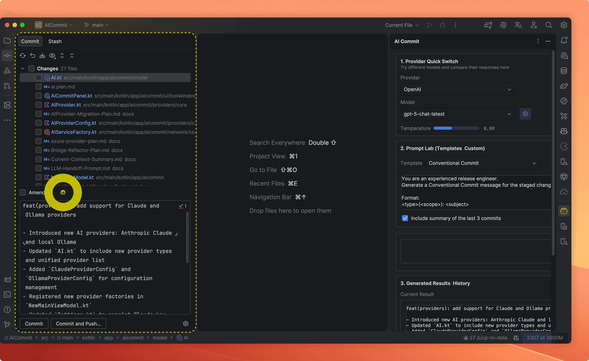
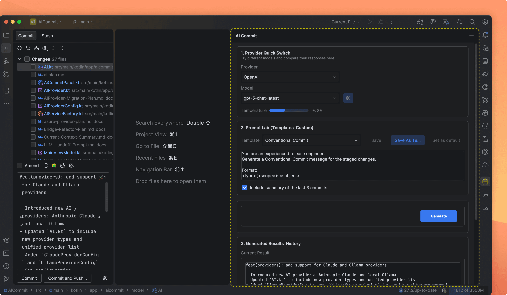
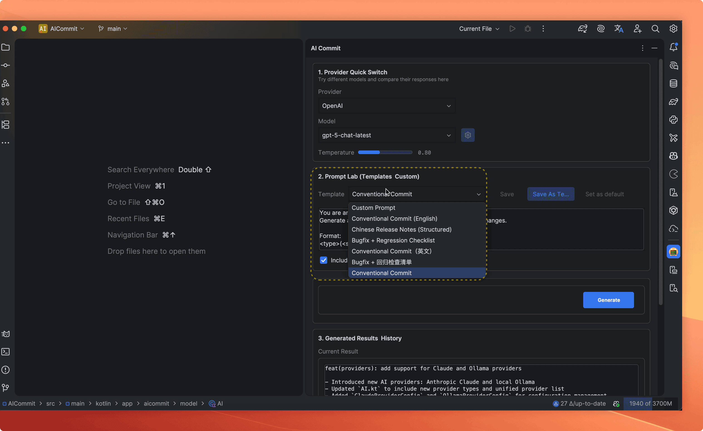

# AICommit
[English](README.md)

依然是 JetBrains IDE 上最好用的 AI Commit Message 体验。

每天节省 30+ 分钟提交信息编写时间。一键生成精准、上下文感知的 Commit Message。支持隐私优先的本地处理，已被 19,000+ 开发者使用。

## 快速入口

- [免费安装插件](https://plugins.jetbrains.com/plugin/21289-aicommit/)
- [FAQ](./FAQ.md)
- [问题反馈](https://github.com/AICommitApp/community/issues)
- [EULA](./EULA.md)

## 为什么选择 AICommit

- **一键生成**：在 JetBrains VCS 提交面板中一键生成提交信息。
- **Prompt Lab + Provider 快速切换**：在同一界面完成 Provider/模型选择、模板应用和历史结果查看。
- **自定义模板**：支持内置模板和自定义模板，覆盖 Conventional Commit、发布说明、Bugfix 回归说明等场景。
- **多 Provider 支持**：OpenAI、Azure OpenAI、Google Gemini、Anthropic Claude、Ollama（本地模型）。
- **隐私优先本地模式**：可使用 Ollama 本地运行，满足更高隐私要求。

## 最新更新（v3.4.4 - 2026-02-26）

- 新增基于 Catalog 的模型管理，Provider/模型选择更一致。
- OpenAI 默认切换为 `responses` 端点模式。
- 提升流式响应与模型列表刷新的稳定性。
- 在切换 Provider 或模型时保留提示词草稿。
- 优化错误提示、本地化文案，以及缺少 API Token 时的设置引导体验。

## 安装

- 使用IDE内置插件系统：

  <kbd>设置/首选项</kbd> > <kbd>插件</kbd> > <kbd>市场</kbd> > <kbd>搜索 “AICommit”</kbd> >
  <kbd>安装插件</kbd>

## 配置 Provider API Key

在 AICommit 设置中选择 Provider（OpenAI / Azure OpenAI / Gemini / Claude / Ollama），并配置对应的 API Key 或服务地址。生成前可点击“验证”确认配置可用。

## 入门

1. 安装插件并在 JetBrains IDE 中打开 AICommit。
2. 选择 Provider 与模型，完成 API Key/服务地址配置并验证。
3. 按需调整 Prompt Lab（模板、自定义 Prompt、默认模板、最近提交上下文）。
4. 点击 **Generate** 生成结果，并插入 Commit 面板。

### 一键生成

### Prompt Lab 与 Provider 切换

### 自定义模板

## 路线图

- [x] 本地化插件
- [x] 多 Provider 支持（OpenAI / Azure OpenAI / Gemini / Claude / Ollama）
- [x] PromptLab（模板管理、自定义 Prompt、默认模板）
- [x] 带进度状态的提交信息生成与 Commit 面板插入
- [ ] 支持过滤文件或文件夹。
- [ ] 支持更多的提交信息模板，前缀和后缀。

## [FAQ](./FAQ.md)

---

## 感谢

- [AICommit](https://github.com/Nutlope/aicommits)：一款使用AI为您编写Git提交信息的CLI。再也不用编写提交信息。
- [Openai-Kotlin](https://github.com/aallam/openai-kotlin)：具有多平台和协程功能的OpenAI API的Kotlin客户端。
- [java-diff-utils](https://github.com/java-diff-utils/java-diff-utils)
- [knuddelsgmbh/jtokkit](https://github.com/knuddelsgmbh/jtokkit)
- 基于[ JetBrains平台插件模板][template]的插件。
- Deja Vu by Cykarl https://soundcloud.com/cykarl
  Creative Commons — Attribution 3.0 Unported — CC BY 3.0
  Free Download / Stream: https://bit.ly/3IPXpnU
  Music promoted by Audio Library https://youtu.be/-tPlIz3eov4

[template]: https://github.com/JetBrains/intellij-platform-plugin-template
